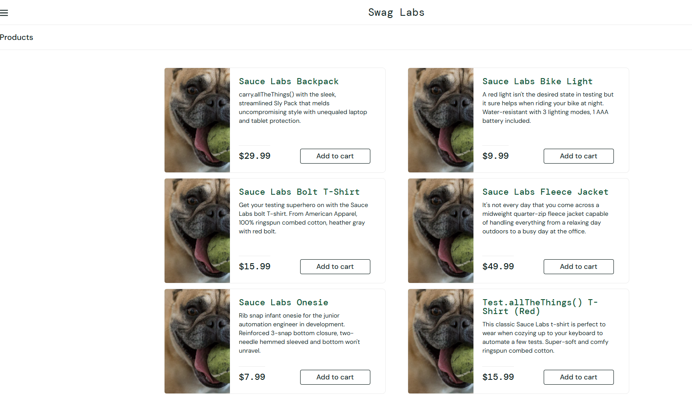

# Bug 001: All products display the same dog image

**Environment:** Chrome, Windows 11, saucedemo.com
**Account:** problem_user
**Severity:** Medium
**Priority:** Medium

## Steps to reproduce
1. Go to saucedemo.com
2. Log in as problem_user
3. Look at the product images on the inventory page

## Expected result
Each product shows its own correct image.

## Actual result
The products show a dog photo instead of the product image.

## Screenshot

