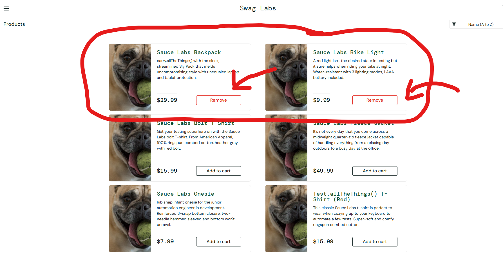

# Bug 002: 2 Remove button's not working after adding to cart

**Environment:** Chrome, Windows 11, saucedemo.com
**Account:** problem_user
**Severity:** Medium
**Priority:** Medium

## Steps to reproduce
1. Go to saucedemo.com
2. Log in as problem_user
3. Click Add to cart on 4 products
4. Go to cart and come back out 
5. Try to remove from cart

## Expected result
You are able to remove all product's from cart after coming out of the cart onto the product page 

## Actual result
Out of the 4 I was not able to remove 2 product's because the button's to remove stopped working after I came back out to the product page from my cart
## Screenshot
