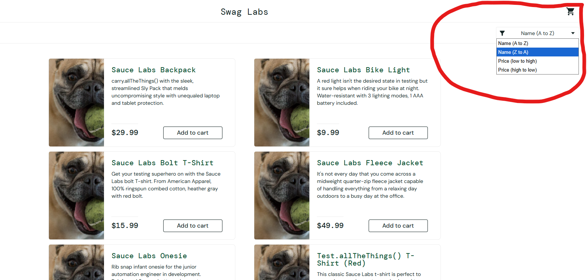

# Bug 003: Filter not working on right side

**Environment:** Chrome, Windows 11, saucedemo.com
**Account:** problem_user
**Severity:** Medium
**Priority:** Medium

## Steps to reproduce
1. Go to saucedemo.com
2. Log in as problem_user
3. Click on filter to the right
4. Try to change the filter to something else 

## Expected result
Able to change the filter as needed 

## Actual result
After filter dropdown appears you are not able to sort to the filter that you want 

## Screenshot
